# Getting started with Jellyfin: your own movie library, from scratch

This guide is for someone who has never set up a media server. By the end you will have
**Jellyfin** (a free program that turns a folder of movies into your own streaming site)
running on your computer, a few **free, legal movies** from the Internet Archive in it, and
the movies playing in your **web browser**. Then, if you want, you will connect it to the
**FreeStuffCrazy Player** so you can watch the same movies from a Tesla or any other browser.

You do not need to know anything technical. Set aside about 30 minutes for Steps 1 to 5,
most of it waiting for downloads, and about 15 more for Step 6.

The screenshots were taken with Jellyfin 12.4. Yours may look slightly different if you
install a newer version, but the names of the buttons will be close.

## What you are about to do

1. **Install Jellyfin** on your computer.
2. **Open it in your web browser** and answer a few setup questions.
3. **Download some movies** from the Internet Archive into a folder.
4. **Tell Jellyfin about that folder.**
5. **Press play** and watch a movie.
6. **Watch from anywhere (optional):** install our connector plugin, link your server to the
   **FreeStuffCrazy Player**, and sign in to the player.

**What you need:** a computer (Windows, Mac or Linux) that you can **leave turned on**, a
web browser (Chrome, Edge, Firefox or Safari; you almost certainly have one), an internet
connection, and a few gigabytes of free disk space.

> **Important: leave the computer on.** Jellyfin runs on the computer you install it on,
> and your movies are stored there too. When that computer is off, asleep, or shut down,
> Jellyfin and all your movies are unavailable, from that computer and from every other
> phone, TV or car that tries to reach it. Plan to install it on a computer that can stay
> on, and plugged in if it is a laptop. See
> [Keep the computer awake](#keep-the-computer-awake) below.

> **A word on what to download.** Only download movies you are allowed to have. The Internet
> Archive (archive.org) hosts a large collection of films that are in the **public domain**
> (their copyright has ended or never applied) or shared under a **Creative Commons**
> license. Those are free and legal. Not everything on the site is free to download, so
> check that the page says Public Domain or shows a Creative Commons license (more on this
> in Step 3).

---

## Step 1. Install Jellyfin

1. Go to **<https://jellyfin.org/downloads/server>** in your browser.
2. Choose your system and download the installer:
   - **Windows:** download the installer (a `.exe` file), open it, and click through the
     steps, accepting the defaults. If it asks whether to install Jellyfin as a service,
     say yes: it then starts by itself whenever the computer does.
   - **Mac:** download the `.dmg` file, open it, and drag Jellyfin into your Applications
     folder. Open it from there. If your Mac says it can't verify the app, open
     **System Settings → Privacy & Security** and choose **Open Anyway**.
   - **Linux:** the page has instructions for your version. Follow those.
3. When the install finishes, Jellyfin is running. On Windows you will see a small
   Jellyfin icon in the corner of your screen near the clock; on a Mac it is in the menu bar
   at the top.

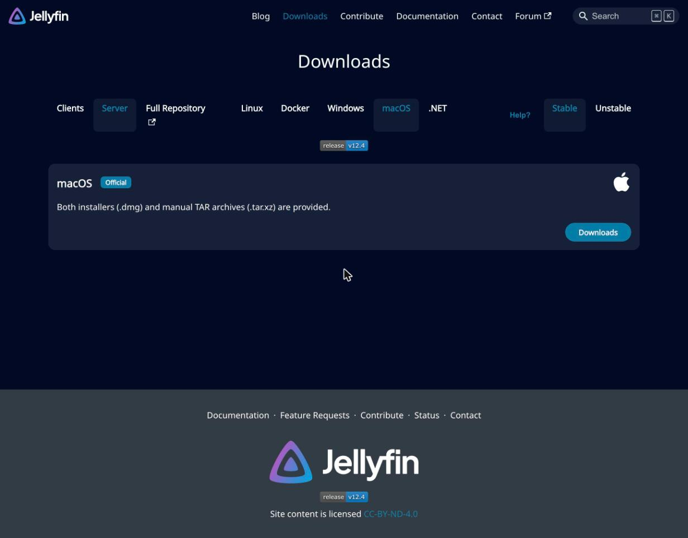

*Jellyfin's download page. Pick your system from the tabs (here, macOS is selected) and
download the installer.*

Jellyfin is free and has no account to sign up for. Everything stays on your computer.

### Keep the computer awake

Computers go to sleep by themselves after a while, and a sleeping computer can't serve
movies. Change that setting once:

- **Windows:** open **Settings → System → Power & battery** (on older versions, **Power &
  sleep**) and set **Screen and sleep** to **Never** for when the computer is plugged in.
  (It is fine for the screen to turn off; the computer itself must not go to sleep.)
- **Mac:** open **System Settings → Displays → Advanced** (or **Battery / Energy**) and turn
  on the option to **prevent automatic sleeping on power adapter when the display is off**.
- **Linux:** in your system's power settings, set automatic suspend to **Off**.

Also **don't shut the computer down or close a laptop lid** while you want to watch.

## Step 2. Open Jellyfin in your browser and set it up

Jellyfin is a website that runs on your own computer, so you use it in your browser.

1. Open your web browser and type this into the address bar at the top, then press Enter:

   ```
   http://localhost:8096
   ```

   (`localhost` means "this computer", and 8096 is the door Jellyfin listens on.)
2. A setup wizard appears. Go through it:
   - **Language:** pick yours, then Next.
   - **Create your user:** choose a name and a password. This is your Jellyfin login. Write
     it down somewhere safe.
   - **Add a media library:** you can skip this for now by clicking **Next**. We'll do it
     after the movies are downloaded.
   - **Metadata language:** leave the defaults and click Next. (Jellyfin uses this to look up
     posters and descriptions for your movies.)
   - **Remote access:** leave "Allow remote connections to this server" checked and click
     Next. This lets your phone or TV on the same Wi-Fi reach it later.
   - Click **Finish**, then sign in with the name and password you just made.

If the page doesn't open, see [If something goes wrong](#if-something-goes-wrong) at the
bottom.

## Step 3. Download some movies from the Internet Archive

First, make a folder for your movies. This is where Jellyfin will look.

1. In your Documents (or Movies) folder, create a new folder called **Movies**.
2. Inside it, we'll make one folder per movie in a moment.

Now find something to watch:

1. Go to **<https://archive.org>**.
2. Click **Video** (the film icon) near the top, or go straight to
   **<https://archive.org/details/feature_films>**. This is the **Feature Films**
   collection, full-length movies.

   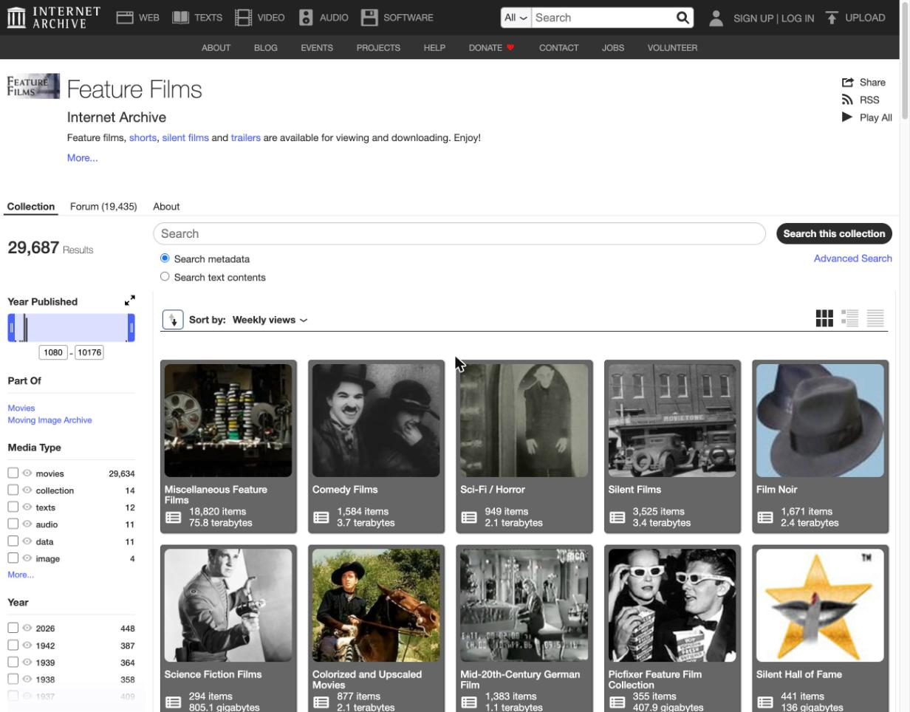
3. Browse, or search by name. Old classics are a good place to start, because many of them
   are in the public domain: try searching for silent films such as **Nosferatu** or **A
   Trip to the Moon**. A good first download is **Big Buck Bunny**
   (<https://archive.org/details/BigBuckBunny_124>), a short animated film that is shared
   under a Creative Commons license and is small (about 420 MB). The Archive's library
   changes over time, and some items get taken out, so if a movie's page says it is no
   longer available, pick another.
4. Click a movie to open its page. **Check that it is free to download:** look at the
   **Usage** line near the title for **Public Domain** or a **Creative Commons** license
   (Big Buck Bunny shows *Attribution 3.0*, which is Creative Commons). If the page says
   the film is restricted or borrowable only, pick a different one.
5. On the right side of the page, find the box called **DOWNLOAD OPTIONS**. Click the
   **H.264** file. That is a normal `.mp4` video file, the kind that plays almost
   everywhere. Some items label it **MPEG4** instead. You can ignore the other choices
   (Cinepack, Ogg Video, Item Tile, Text and Torrent).

   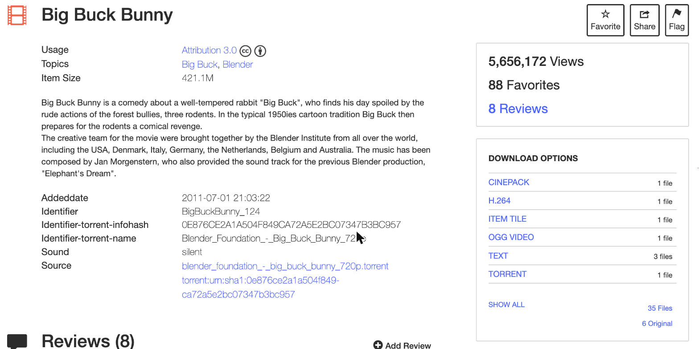

   *Big Buck Bunny's page: the license is on the **Usage** line, and the file to download
   is **H.264** in the **Download Options** box.*
6. Wait for the download to finish. A movie is usually between half a gigabyte and a couple
   of gigabytes.

### Put each movie in a folder with the right name

Jellyfin finds the correct poster and description for a movie by reading its name. It works
best when each movie sits in its own folder named **Title (Year)**, and the file inside
has the same name:

```
Movies
├── Big Buck Bunny (2008)
│   └── Big Buck Bunny (2008).mp4
├── Nosferatu (1922)
│   └── Nosferatu (1922).mp4
└── A Trip to the Moon (1902)
    └── A Trip to the Moon (1902).mp4
```

So for each movie you download:

1. Make a folder inside **Movies** called `Title (Year)`, using the real title and the
   year it came out (you can find the year on its Internet Archive page, or by searching the
   title).
2. Move the downloaded file into that folder.
3. Rename the file to match, keeping `.mp4` at the end.

## Step 4. Tell Jellyfin where your movies are

1. In the Jellyfin page in your browser, click your **profile picture** (the round icon at
   the top right), then choose **Dashboard**.

   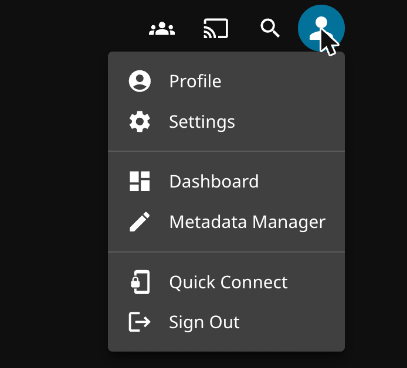
2. In the menu on the left, click **Libraries**; a short list opens under it. Click
   **Libraries** in that list. You will see the libraries you have so far (none yet), and
   the **Add Media Library** button. Click it.

   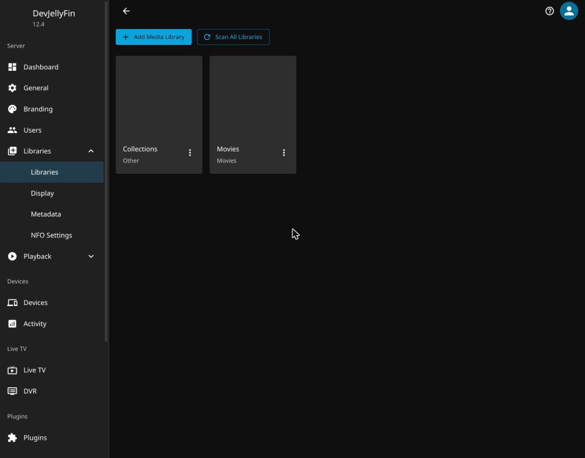
3. For **Content type**, choose **Movies**.
4. Give it a **Display name**, such as `Movies`.
5. Next to **Folders**, click the **+** button, browse to the **Movies** folder you made
   (the main one, not one of the movie folders inside it), and click **OK**.
6. Leave the other settings alone and click **OK** at the bottom.

   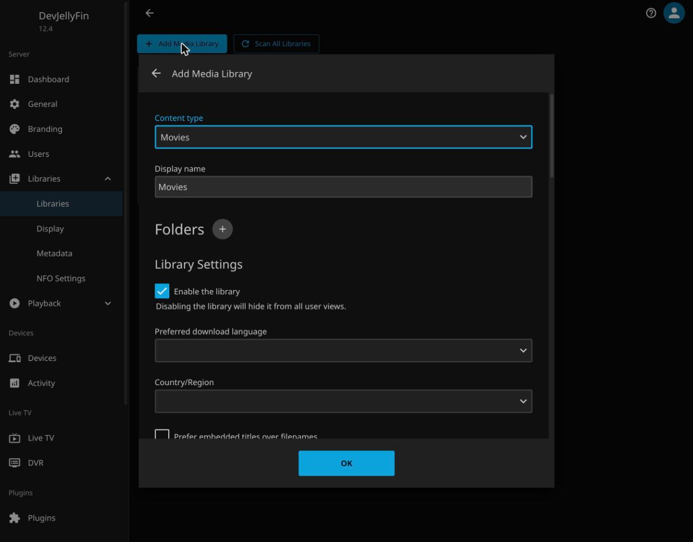

   *The Add Media Library window. Choose **Movies**, name it, then use the **+** next to
   **Folders** to pick your Movies folder.*

Jellyfin now scans the folder and looks up a poster and description for each movie. This
takes a minute or two.

## Step 5. Watch a movie

1. Click the Jellyfin logo or **Home** to go back to the start page.
2. Open the **Movies** library. Your movies appear with their posters.
3. Click one to open its page, then click the **▶ Play** icon.

   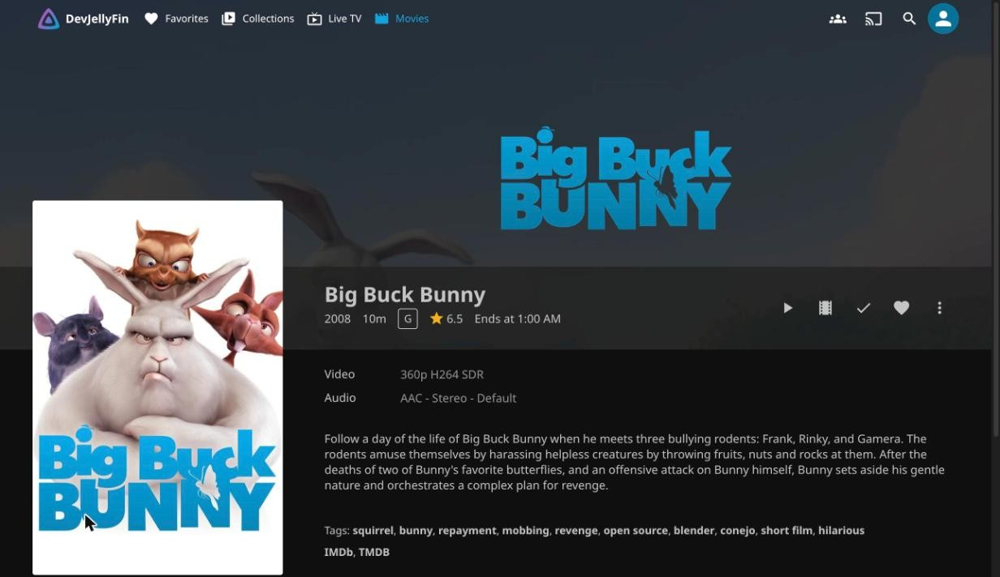

   *A movie's page. The ▶ icon next to the title starts it.*

That's it. You now have your own movie site. Anything you add to the **Movies** folder
later (in the same `Title (Year)` folder layout) shows up after Jellyfin's next scan. To
make it look right away, go to **Dashboard → Libraries** and click **Scan All Libraries**.

---

## Step 6. Watch it in the FreeStuffCrazy Player (and in your Tesla)

So far you watch on the computer that runs Jellyfin. The **FreeStuffCrazy Player** is a
website that plays your Jellyfin library in any browser, including a Tesla's, where a
passenger can use it while the car is moving. To reach your server from outside your home
without any router settings, you install our small **connector plugin** into Jellyfin. It
makes one outgoing connection from your computer to the player, so there is nothing to
open on your router, no port forwarding and no SSL certificate to set up.

This step is optional. If you only want to watch on the computer that runs Jellyfin, or on
your home Wi-Fi, you can stop at Step 5. (If your Jellyfin is already reachable from the
internet at its own `https://` address, you don't need the plugin: type that address in
[6c](#6c-sign-in-to-the-freestuffcrazy-player) instead of a server name.)

> **Know what you're agreeing to.** Everything you watch through the player, including
> sign-in requests and the video itself, passes through the FreeStuffCrazy relay, which can
> see it. Only do this if you're comfortable with that. The plugin's
> [Privacy and security](https://github.com/FreeStuffCrazy/jellyfin-plugin-freestuffcrazy#privacy-and-security)
> section explains exactly what it sends. Streams are limited to about 2 Mbps, and the
> hosted player may change or limit what it offers without notice (see the
> [README](README.md)).

### 6a. Install the connector plugin

You do this in Jellyfin, on the computer where it is installed. It needs Jellyfin 10.9 or
newer.

1. Open Jellyfin in your browser (`http://localhost:8096`), click your **profile picture**
   at the top right, then **Dashboard**.
2. In the menu on the left, click **Plugins**. On the Plugins page, click **Manage
   Repositories** at the top right, then **New Repository**.

   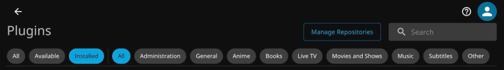
3. For **Repository Name** type `FreeStuffCrazy`. For **Repository URL**, paste exactly this
   and click **Add**:

   ```
   https://github.com/FreeStuffCrazy/jellyfin-plugin-freestuffcrazy/releases/latest/download/manifest.json
   ```

   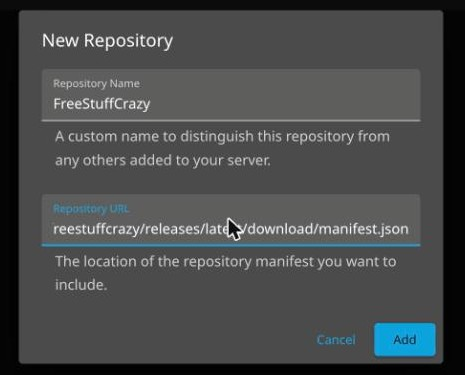

   A plugin runs inside your server, so only add repositories you trust.
4. Go back to the **Plugins** page, click the **Available** button in the row of filters, and
   type `FreeStuff` into the **Search** box. **FreeStuffCrazy Player Connector** appears.
   Click it.

   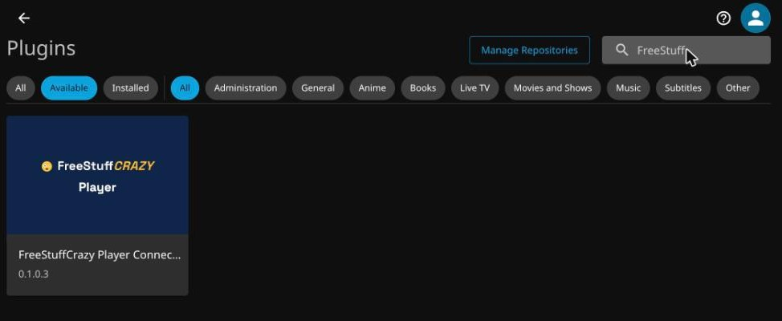
5. On the plugin's page, click **Install**. (Jellyfin notes that it will need to be restarted
   afterwards.)

   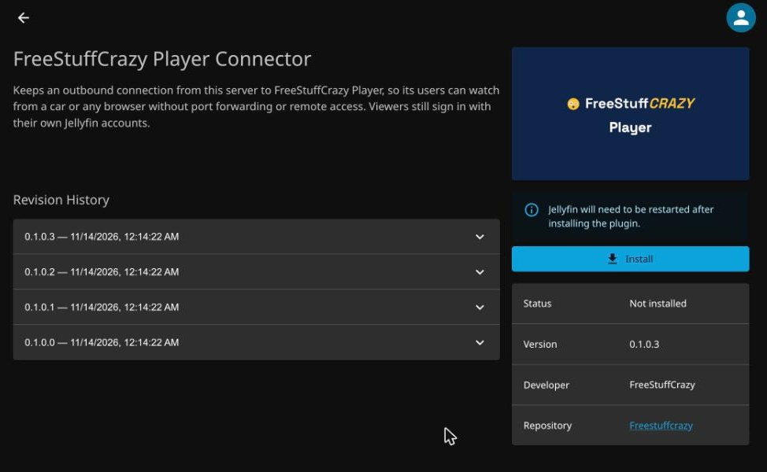

   Jellyfin warns that third party plugins carry risks. If you are happy to go on, click
   **Install** again to confirm.

   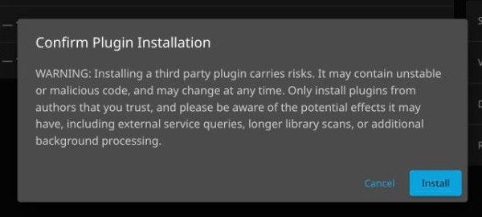

   The page then says the plugin was installed and the server must be restarted.
6. **Restart Jellyfin** so it starts the plugin. Go to **Dashboard**, click **Restart**, and
   confirm. (You can also restart it from the Jellyfin icon near the clock on Windows, or the
   menu bar on a Mac.) Give it a minute, then refresh the page.

   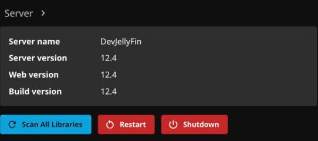

### 6b. Link your server to the player

1. Back in the Jellyfin **Dashboard**, open **Plugins**, click the **Installed** filter, and
   click **FreeStuffCrazy Player Connector**, then **Settings**.
2. Wait until the status says **Connected, waiting to be linked**. (If it says *Connecting*,
   give it a few seconds. If it says *Not connected*, check that the computer is online.)

   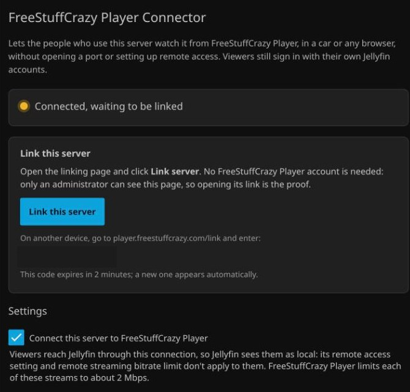

   *(The code under the button is hidden in this picture. Yours shows a code you can use to
   link from another device.)*
3. Click **Link this server**. A page at the player opens (it may open in a new tab) asking
   *Link this Jellyfin server?*; click **Link server** on it.

   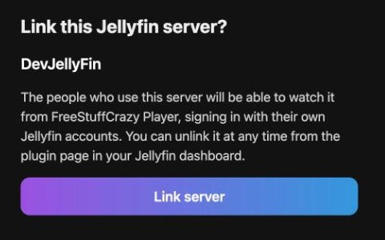

   The page then says **Linked** and shows your server name, with a button to sign in
   straight away. You can use that button to skip ahead to the sign-in in
   [6c](#6c-sign-in-to-the-freestuffcrazy-player).

   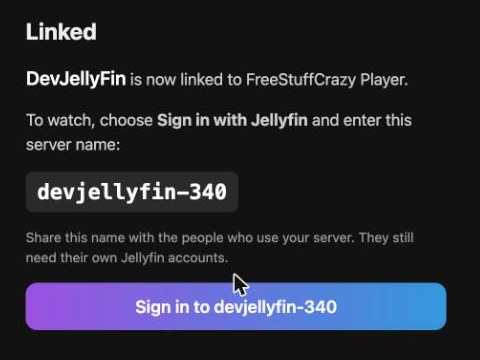

   To link from another device (a phone, say), go to **<https://player.freestuffcrazy.com/link>**
   and type in the code shown on the plugin page. Codes run out after a few minutes; a new
   one appears by itself.
4. The page now shows your **Server name**, in a box with a **Copy** button. **Write it
   down:** you will type it into the player in a moment, and so will anyone you share your
   server with. Only a Jellyfin administrator can see this page, which is how the player
   knows the server is yours. You don't need a FreeStuffCrazy account.

   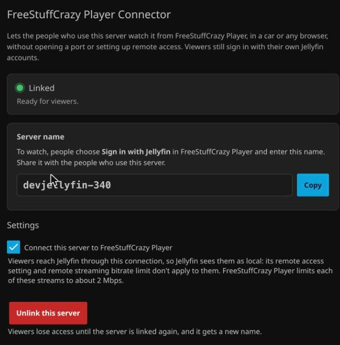

To stop sharing, click **Unlink this server** on the same page (anyone watching loses
access, and linking again gives a new server name), or uncheck **Connect this server to
FreeStuffCrazy Player** to pause it.

### 6c. Sign in to the FreeStuffCrazy Player

1. On any computer, phone, or in the Tesla's browser, go to
   **<https://player.freestuffcrazy.com>**. (If you used the **Sign in** button on the
   Linked page, you are already here: skip to step 4.)
2. Click **Sign in with Jellyfin**.

   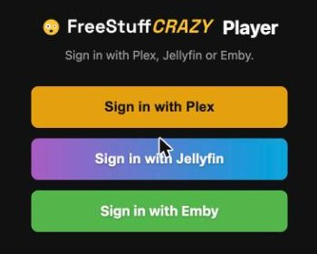
3. Type the **server name** from the plugin page into the box for the server, and click
   **Continue**.

   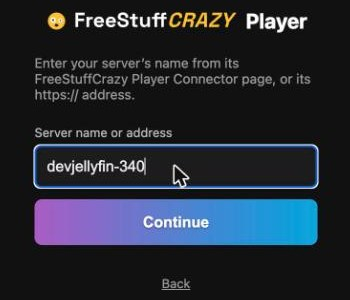
4. Sign in with your Jellyfin account. You can use either:
   - **Quick Connect:** the player shows a short code. In Jellyfin on the web page you
     already use, click your **profile picture**, choose **Quick Connect**, type the code and
     confirm. (In a Jellyfin phone or TV app it is under **Settings → Quick Connect**.) If
     Quick Connect is switched off, turn it on in **Dashboard → General → Enable Quick
     Connect on this server**, or use the password instead.
   - **Your username and password:** click **Use a username and password instead** and type
     the Jellyfin name and password you made in Step 2.

   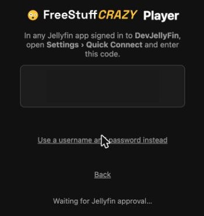

   *(The code is hidden in this picture.)*
5. Your libraries appear. Pick a movie and press play.

In a Tesla, open the same address in the car's browser and sign in the same way. Quick
Connect saves typing a password on the car's screen: start the sign-in in the car, and type
the code into Jellyfin on your phone.

**Remember:** your computer with Jellyfin on it must be **on, awake and online** for any of
this to work (see [Keep the computer awake](#keep-the-computer-awake)). If the plugin shows
*Not connected*, the player can't reach your movies.

## What next?

- **Watch on other devices at home.** Other computers, phones and tablets on the same Wi-Fi
  can open `http://` followed by your computer's address on your network and `:8096`, for
  example `http://192.168.1.20:8096`. (Your computer's address is shown in its network
  settings.) Jellyfin also has free apps for phones, tablets and TV boxes: see
  <https://jellyfin.org/downloads/clients>.
- **Watch it in a Tesla (or away from home).** That is [Step 6](#step-6-watch-it-in-the-freestuffcrazy-player-and-in-your-tesla).
  **The computer with Jellyfin on it must be on, awake and online** when you want to watch,
  even though you are in the car.
- **Add more.** The Internet Archive also has a large collection of old TV shows, cartoons,
  and classic educational films. Shows and cartoons need a different folder layout: see
  Jellyfin's own guide at <https://jellyfin.org/docs/general/server/media/shows/>.

## If something goes wrong

**Jellyfin worked yesterday but I can't reach it now.**
The computer it is installed on is probably asleep, switched off, or offline. Wake it up
(or turn it on), give it a minute, and try again. See
[Keep the computer awake](#keep-the-computer-awake) to stop it going to sleep.

**The page at `localhost:8096` won't open.**
Jellyfin may not be running. On Windows, look for its icon near the clock and start it from
the Start menu if it is missing. On a Mac, open Jellyfin from Applications. Then try the
address again. Make sure you typed `http://` and not `https://`.

**A movie doesn't show up in the library.**
Check that the file is inside a `Title (Year)` folder inside the folder you added, and that
it ends in `.mp4`. Then go to **Dashboard → Libraries** and click **Scan All Libraries**.

**A movie shows the wrong poster or the wrong name.**
Open the movie, click the **three dots** (⋮) menu next to the play icon, then **Identify**.
Search for the right title and pick the correct match.

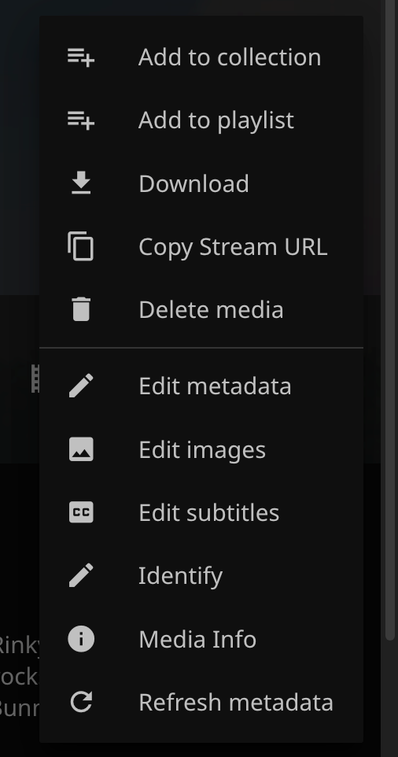

**It plays without sound, or won't play at all.**
Go back to the Internet Archive page and download the **H.264** (`.mp4`) version rather than
another format. Those play in every browser.

**The plugin doesn't appear in the catalog.**
Check that the repository address in Step 6a is exactly right, with no spaces, and that the
computer is online. Open **Manage Repositories** to confirm it is listed, then go back to
the Plugins page, click **Available**, and search again.

**The plugin says "Not connected" or never says "waiting to be linked".**
The computer may be offline, or Jellyfin hasn't been restarted since the plugin was
installed. Restart it from the Dashboard (Step 6a) and give it a minute. Make sure
**Connect this server to FreeStuffCrazy Player** is checked.

**The player says it can't find my server.**
The server name has to be typed exactly as the plugin page shows it. Use its **Copy**
button. If you unlinked and linked again, the name changed: use the new one.

**The player shows a Quick Connect code but nothing happens.**
Enter the code in a Jellyfin page where you are signed in (profile picture → **Quick
Connect**) within a few minutes. If Quick Connect isn't available, turn it on in
**Dashboard → General**, or click **Use a username and password instead**.

**A movie is blurry or in black and white.**
Old films often are. That is how they were made, not a mistake.

**I'm not sure it's legal to download a film.**
If you're not sure, don't download it. Stick to films the Internet Archive marks as
**Public Domain** or Creative Commons, and use only the Internet Archive or similar sites
that clearly say a film is free to download.
